# Tissue patch evaluation

I built this comparison because I wanted to check whether tissue patches from the same slide make an image classifier look more reliable than it is on a new slide.

**This is a public-data learning experiment, not a diagnostic tool.** It cannot decide whether a person has cancer.

## What I measured

I evaluated 32,768 public patches from 54 source slides. Random splitting scored 16.08 percentage points higher in accuracy (95% interval: 9.42 to 22.94 points). This is the measured difference for this experiment, not a guaranteed effect on other data.

| Split method | Accuracy (95% interval) | Balanced accuracy | ROC AUC |
| --- | --- | --- | --- |
| Random patches | 91.83% [90.12%, 93.22%] | 91.83% [90.29%, 93.20%] | 0.9750 [0.9647, 0.9837] |
| Separate source slides | 75.75% [69.22%, 82.25%] | 75.74% [69.57%, 81.57%] | 0.8781 [0.8375, 0.9136] |

Accuracy is the share of correct patch labels. Balanced accuracy averages the success rate for each label. ROC AUC measures how well the scores rank positive patches above negative patches; higher is better. Square brackets show uncertainty, not score ranges.

Source: Official PCam validation archive from Zenodo record 2546921, with original CAMELYON16 wsi metadata. Positive labels: 16,369. Repeated coordinate rows: 4660; repeated image rows: 4660.

## What makes this a source-aware comparison

I train a fixed 96-tree random forest using 84 color and texture measurements per image, with 5 folds (separate train/test rounds). Each row gets exactly one prediction from a model that did not train on that row. The random split can still put an exact copy of its image in training. The random protocol mixes source slides across training and testing. The slide protocol keeps every patch from a source slide together. Both score the same rows, use the same image features, hyperparameters, probability threshold of 0.5, and seed. Slide IDs, coordinates and metadata labels never enter the model. Nothing is tuned on these results.

This re-partitions the official validation archive as a small development experiment. It is not a score on the official PCam train/test benchmark. The archive contains exact image repeats; the audit shows whether those copies cross folds. Repeated images can make random evaluation easier, so the gap cannot be attributed only to stain or slide appearance. Group folds can have different class mixes and training sizes, which are shown below. The observed gap combines source similarity and split composition; it does not isolate a causal effect of leakage. The published benchmark already separates slides. I do not claim to have found leakage in it. I use actual CAMELYON16 slide IDs, and do not infer hospitals from slide names.

Intervals use 1,000 paired bootstrap draws: sample whole source slides with replacement, keep all of their patches, then recompute both scores and their difference. The interval for the difference uses the same slides in both protocols. These intervals condition on the fitted models and this archive. They do not include retraining uncertainty or establish clinical performance.

| Protocol / fold | Train patches | Test patches | Train slides | Test slides | Shared slides | Shared image hashes | Train positive share | Test positive share |
| --- | --- | --- | --- | --- | --- | --- | --- | --- |
| random / 0 | 26214 | 6554 | 54 | 54 | 54 | 968 | 49.95% | 49.95% |
| random / 1 | 26214 | 6554 | 54 | 54 | 54 | 966 | 49.95% | 49.95% |
| random / 2 | 26214 | 6554 | 54 | 54 | 54 | 968 | 49.95% | 49.95% |
| random / 3 | 26215 | 6553 | 54 | 54 | 54 | 942 | 49.95% | 49.96% |
| random / 4 | 26215 | 6553 | 54 | 54 | 54 | 975 | 49.96% | 49.95% |
| slide / 0 | 26195 | 6573 | 44 | 10 | 0 | 0 | 49.72% | 50.91% |
| slide / 1 | 26124 | 6644 | 42 | 12 | 0 | 0 | 49.75% | 50.77% |
| slide / 2 | 25857 | 6911 | 43 | 11 | 0 | 0 | 49.91% | 50.14% |
| slide / 3 | 26336 | 6432 | 44 | 10 | 0 | 0 | 50.16% | 49.13% |
| slide / 4 | 26560 | 6208 | 43 | 11 | 0 | 0 | 50.24% | 48.73% |

## Quality flags and real prediction errors

I flag low sharpness (blur), large connected areas of saturated blue/green/red (possible pen), and mostly pale, unsaturated pixels (background). The thresholds are fixed image heuristics, not expert annotations. Natural stain or tissue structure can trigger them. Flags can overlap; I keep every patch in the evaluation rather than remove hard cases.

The table uses slide-separated predictions. Each error rate has a slide-bootstrap interval. A positive difference means flagged patches made more errors. An association does not prove that a defect caused the errors. A missing interval means there were no observations in a needed stratum, not that its error rate was zero. A zero-error stratum can have a collapsed bootstrap interval; that does not guarantee zero future errors.

| Flag | Flagged patches / slides | Flagged error rate | Unflagged patches | Unflagged error rate | Difference (percentage points) |
| --- | --- | --- | --- | --- | --- |
| blur | 168 / 44 | 0.00% [0.00%, 0.00%] | 32600 | 24.37% [17.86%, 30.93%] | -24.37 pp [-30.93 pp, -17.86 pp] |
| pen | 3407 / 29 | 21.66% [13.13%, 31.39%] | 29361 | 24.55% [17.72%, 31.35%] | -2.88 pp [-12.95 pp, 6.21 pp] |
| background | 1111 / 51 | 0.27% [0.00%, 0.88%] | 31657 | 25.09% [18.44%, 31.67%] | -24.82 pp [-31.45 pp, -18.37 pp] |

### Real patch examples

Examples are the first available correct and incorrect predictions in each flag group, with duplicate examples removed. They are illustrative, not a random prevalence sample. A positive label means tumor pixels occur in the central region; surrounding tumor alone does not make the label positive. The score is the model's positive-class score, not a calibrated clinical probability.

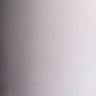

Row 108, camelyon16_train_tumor_057; label 0, score 0.301; flags: blur; correct prediction

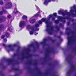

Row 11, camelyon16_train_tumor_081; label 1, score 0.080; flags: pen; incorrect prediction

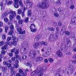

Row 16, camelyon16_train_tumor_073; label 1, score 0.956; flags: pen; correct prediction

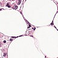

Row 247, camelyon16_train_tumor_046; label 1, score 0.000; flags: background; incorrect prediction

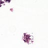

Row 19, camelyon16_train_normal_057; label 0, score 0.000; flags: background; correct prediction

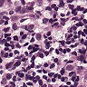

Row 1, camelyon16_train_tumor_069; label 1, score 0.237; flags: none; incorrect prediction

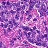

Row 0, camelyon16_train_tumor_085; label 1, score 0.925; flags: none; correct prediction

## Deliberately damaged patches: a separate stress check

I pick a fixed random subset before training and apply Gaussian blur, a blue line, or a white rectangle covering most of each real image. Each damaged patch is scored by the same slide-held-out model as its original. These are simulated defects, not verified natural pen marks or background. I retain the original label to measure sensitivity to damage, although occlusion can remove the evidence needed to infer that label. Detection rates here are not estimates of sensitivity on natural defects.

| Damage | Patches | Intended flag fires | Original error rate | Damaged error rate |
| --- | --- | --- | --- | --- |
| blur | 256 | 100.00% | 24.22% | 54.30% |
| pen | 256 | 100.00% | 24.22% | 39.45% |
| background | 256 | 100.00% | 24.22% | 54.30% |

| Original | Blur | Simulated pen | Simulated background |
| --- | --- | --- | --- |
| 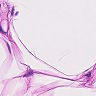 | 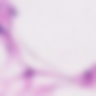 | 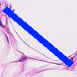 | 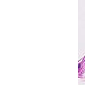 |

## Reproduce and inspect

```sh
uv sync --frozen --extra dev
uv run tissue-patch-eval fetch --data data
uv run tissue-patch-eval run --data data --out reports
uv run tissue-patch-eval verify --report reports
```

`results.json` contains configuration, file checksums, versions, fold audits and all statistics. `predictions.csv` retains every row's source, coordinates, patch hash, label, folds, scores and QC measurements. `stress_predictions.json` retains the separate damaged patch results. The verify command replays metrics and every interval without raw images. See [method details](../docs/method.md) for thresholds and scope.

Public sources: [PCam release and labeling](https://github.com/basveeling/pcam), [download archive](https://zenodo.org/records/2546921), [PCam paper](https://arxiv.org/abs/1806.03962), [CAMELYON16 paper](https://doi.org/10.1001/jama.2017.14585). The source patches and these derived examples are CC0. No private data was used.
